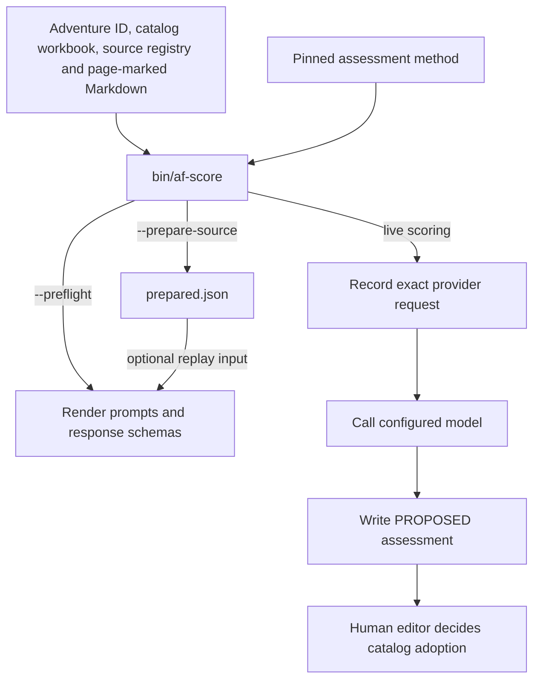

<a name="af-scorer-source-candidate"></a>

# af-scorer

The AdventureFinder scorer is a Ruby CLI that takes an Adventure ID, a catalog
workbook, a source registry and page-marked Markdown, and a pinned public
assessment method. It writes a prepared-source JSON file that binds the source
and policy, then reuses it in preflight to render the exact prompts and response
schemas for a blind assessment.

## Scorer architecture



## Offline first operation

Start with `ADV-0001`, a synthetic case generated by the
[offline smoke script](script/offline_smoke.rb). It uses a one-row workbook,
a v0.1 source registry and numeric page text. The smoke needs Git, Ruby 4.0.9,
Bundler 4.0.17, the gems in `Gemfile.lock` (including the test group), and system
`zip` and `unzip`. The runtime was tested on arm64 macOS. All inputs are public
or generated locally. You need no provider credentials, service, model or
private catalog.

Get the scorer and its two public dependencies over HTTPS. Check out the exact
[specification revision](#exact-public-method-dependency) and the source
Markdown reader revision used by scorer CI.

```sh
demo="$(mktemp -d "${TMPDIR:-/tmp}/af-scorer-demo.XXXXXXXX")" &&
demo="$(cd "$demo" && pwd -P)" &&
git clone https://github.com/dtnorris/af-scorer.git "$demo/af-scorer" &&
git clone https://github.com/dtnorris/af-specification-md.git "$demo/af-specification-md" &&
git -C "$demo/af-specification-md" checkout --detach 394a44c2c2052ce2eeb6d28cd7647ad8a50acfcf &&
git clone https://github.com/dtnorris/af-source-md.git "$demo/af-source-md" &&
git -C "$demo/af-source-md" checkout --detach 3611758b7dadfb88f46d011aa3b35c3dda575c62
```

Run the offline check from the scorer checkout. If `bundle check` reports missing
gems, acquire the locked dependencies separately through your trusted Ruby setup
before retrying. The smoke creates the evidence directory, so leave that path absent.

```sh
cd "$demo/af-scorer" &&
BUNDLE_FROZEN=true bundle check &&
AF_SOURCE_MD_ROOT="$demo/af-source-md" bundle exec ruby script/offline_smoke.rb \
  "$demo/af-specification-md" "$demo/smoke"
```

Look for `"result":"PASS"` and `"prepared_contract":"afsu-prepared-source/v0.2"`
in the JSON summary. Open these files in `$demo/smoke` to see what was produced.

| File | What it contains |
| --- | --- |
| `prepared.json` | Prepared source for `ADV-0001`, including catalog, registry and source hashes and source policy. |
| `preflight.json` | Exact prompts and response schemas for eight scoring targets, with pinned method provenance. |
| `requests.json` | Eight rendered provider request artifacts, built with an inert client. |
| `summary.json` | The result, target prompt and schema hashes, and the request file SHA-256. |

The smoke runs the real `bin/af-score --prepare-source`, then
`--preflight --prepared-source`, in fresh processes with a cleared environment.
It checks that both operations refuse a missing `documents.json` and that
restoring the exact bytes reproduces the preflight output byte for byte. The CLI
observations require zero provider constructions and executions. These files
contain prepared inputs only. For live scoring and the separate catalog adoption
decision, see [explicit inputs and configuration](#explicit-user-inputs-and-configuration).

Keep evidence private and outside the checkout. It includes raw status, stdout,
stderr, observed reads, loaded code paths and hashes, and rendered requests.
Additional absolute forbidden roots may follow the two arguments. The Ruby File
observer rejects those reads and records loaded scorer identities. Zip/unzip
process boundaries are audited separately. The observations cover Ruby File
operations after observer load and do not provide kernel confinement or universal
native I/O tracing.

## Distribution and prerequisites

The historical source-candidate procedure prepared an explicit regular-file
archive for private review. It excluded Git history, private catalogs/books,
actual configurations, raw prompts/responses and run packages. Only `Manifest.txt`
members enter the archive.
The private sidecar inventory records every path, mode, size and SHA-256 plus the
archive digest. The inventory stays outside the public import. David owns the
exact import set and public history. No predecessor ancestry or old
qualification is transferred.

Tested runtime: Ruby 4.0.9, Bundler 4.0.17 on arm64 macOS. Ruby/Bundler, the exact
gems in `Gemfile.lock`, and system `zip`/`unzip` are separately acquired public
dependencies. Dependencies are not downloaded by package or smoke commands.
Other platforms are unqualified. See [THIRD_PARTY_NOTICES.md](THIRD_PARTY_NOTICES.md).

For the historical packaging procedure, start from a reviewed source candidate
and use output paths outside it.

```sh
ruby script/source_package.rb build . /absolute/private/af-scorer.tar /absolute/private/inventory.json
ruby script/source_package.rb unpack /absolute/private/af-scorer.tar /absolute/private/inventory.json /absolute/fresh/af-scorer
cd /absolute/fresh/af-scorer
ruby --version
bundle --version
bundle check
```

If dependencies are absent, stop the offline checks and acquire the locked
dependencies separately using your normal trusted setup. No credentials, provider
service, Ollama process or model is needed for preparation/preflight.

To repeat the offline check from the independently unpacked directory, provide
the [exact public specification](#exact-public-method-dependency), the source
Markdown reader from the [offline first operation](#offline-first-operation),
and an absent private evidence directory.

```sh
AF_SOURCE_MD_ROOT=/absolute/public-source-md bundle exec ruby script/offline_smoke.rb \
  /absolute/public-specification /absolute/private/smoke
```

The historical archive proof performed no live scoring or qualification.

## Exact public method dependency

Acquire `dtnorris/af-specification-md` revision
`394a44c2c2052ce2eeb6d28cd7647ad8a50acfcf` separately through a trusted source.
Do not follow main or substitute another version. The required files are:

| File | SHA-256 |
| --- | --- |
| documents.json | 5ebb0fffcafa165a71bd3afef70e483217074d788d02ff9241ab3cedfd6bf0e6 |
| AdventureFinder_Analysis_Ontology_AFAO_v1.6.1.md | dcfad224ab9517272504a508f935a804032d04a7c812ede10498921ce4585fa1 |
| AdventureFinder_Analysis_Data_Assessment_Specification_v0.1.md | bbd90a20daafb58c3daee3af758972f09f658b271086e95060ce01df44197ad0 |

The actual scorer verifies these complete bytes at startup and preparation,
including replay: nineteen dimensions, 85 primary anchors and ten assessment
sections plus common/outside-section rules remain bound. Missing, changed,
wrong-version or incomplete definitions refuse before provider construction.
AFAO 1.6.1 remains Candidate pending targeted GM Preparation Burden 4/5
revalidation; Editorial Rev 2.0 remains Draft. ABDS 1.4 governs new upstream
source preparation. The standalone historical Salvage Operation freeze supplies
no forward fallback and is not a runtime input.

## Explicit user inputs and configuration

Source registry resolution and raw page slicing now delegate to the standalone
`af-source-md` API `af-source-md/v0.1`, requiring Ruby 3.2+. Select the exact
reviewed owner tree with absolute `AF_SOURCE_MD_ROOT`, or supply `af_source_md`
on Ruby's load path when the variable is absent. Explicit missing, blank,
invalid or unsupported selection refuses without an ambient/historical fallback;
keep selection fixed for the process. The scorer adapter preserves its public
Resolution/Extraction types and error classes, lazy mapping checks, warnings,
source policy, Levels-context heuristics and complete prepared-source v0.2
replay. MD owns marker inventory and byte reads; scorer retains permission for
clamp/full-source scope and context selection. Selecting this candidate does not
requalify a frozen method or rewrite historical v0.1 artifacts.

`config/default.yml` is a template: its three input roots are deliberately unset.
Select all roots explicitly; there is no private sibling default. For example,
with your own catalog, source registry and content, and the exact method above:

```sh
export AF_XLSX_ROOT=/absolute/owned/catalog
export AF_SOURCE_ROOT=/absolute/owned/source
export AF_SPEC_ROOT=/absolute/public-specification
export AF_OUTPUT_DIR=/absolute/private/proposals
bin/af-score --prepare-source /absolute/private/prepared.json ADV-0001
bin/af-score --preflight --prepared-source /absolute/private/prepared.json --render-preflight /absolute/private/preflight.json ADV-0001
```

These paths are examples requiring explicit user choices. Set
`AF_CATALOG_WORKBOOK` or `files.catalog` to select a workbook directly. Otherwise
the scorer validates all three bindings and version ceilings in `PROJECT_STATE.yml`
and selects `catalog_head` by default. Use `AF_CATALOG_ROLE` to select another
role or `AF_PROJECT_STATE` to locate a different manifest. Catalog workbooks require
Adventure ID, Adventure Title, Page Count, Source Book, Book Publisher, Start Page
and End Page fields. The source registry is `source_registry.yml` under the
selected source root, using `adventurefinder-source-registry/v0.1`; registry
entries map Source Book to an owned Markdown file or explicit page segments.
Source files carry numeric `<!-- PAGE: 1 -->` or `<!-- PDF Page 1 -->` markers.
No actual catalog, workbook, source text or registry is distributed.
A private YAML overlay supplied with `--config` may select these paths instead.
The source owner retains responsibility for identity, content rights and boundaries.

Ordinary preparation, preflight and scoring ignore incidental absent, missing or
malformed regression workbooks. Explicit regression requires its selected valid
workbook and contextual eligibility before provider construction. Workbooks
enumerate cases; expected values remain AFAO-owned and are read after blind scoring.

Historical comparisons/source exceptions require explicit trusted
`afsu-target-eligibility/v0.1` selections with exact resolved catalog, registry,
source path/hash, adventure metadata, page offset, policy and AFAO digest.
An ADV label or observed digest alone establishes no historical membership.
Keep original frozen scorer, method, config and source bindings for replay.
New v0.2 payloads re-resolve live owner inputs; v0.1 payloads refuse here and
must use their original scorer. Historical `method.identity: configured` remains
explicitly selectable using retained exact definitions, without a public-identity claim.

All profile implementations remain included. Canonical loading ignores retained
profile environment variables; historical experiments require explicit
`require "af_scoring/experiments"` and their original selection. Retained NoS
supports Stage-1 preflight only, has no prepared-source replay, and refuses regression.
Never relabel old profiles/results or carry qualifications across new bindings.

Live scoring is a separate run. Configure the provider and model in a private
overlay and authorize the provider runtime. With the inputs above, run
`bundle exec bin/af-score --config PATH ADVENTURE_ID` with your overlay path and
Adventure ID. Scoring records request provenance before inference and writes any
successful assessment as `PROPOSED`. Catalog adoption requires a separate
decision by the responsible human editor.

The [review rules](specifications/AdventureFinder_Automated_Assessment_Review_Rules_v0.1-draft.md)
and [CSV contract](docs/csv-contract.md) describe proposal status and review.
See the [request provenance contract](docs/inference_request_provenance.md) for
live inference records and the [code status policy](docs/CODE_STATUS.md) for
current and retained profiles.

## Offline suite and integration boundary

With the exact public method available:

```sh
AF_TEST_SPEC_ROOT=/absolute/public-specification bundle exec rake test
```

The complete `test/**/*_test.rb` discovery remains intact. Tests generate local
mechanical inputs and fake only declared external provider/client boundaries.
The four benchmark-ID text fixtures are test support, not scoring inputs.

AFW's WL-04 owner must reconcile the actual scorer identity, prepared-source v0.2,
target selections, method/profile/request/schema hashes, ScorerAdapter HEAD and
closed-environment checks, and QualificationAttempt.freeze_contract (historical
v0.1 hashes its regression workbook unconditionally). No workload pin, frozen
result, model qualification or consumer acceptance changes with this archive.
David owns checkpoint record/verify, full-suite gates, integration, exact-set
rights review, target setup/naming, publication and final acceptance.
